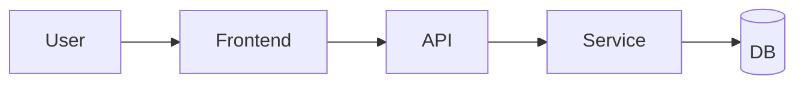

# Outside-the-box and critical thinking

*Last updated: 2026-10-13 | Version-sensitive: none significant (method); any market facts must be searched | Re-check current docs before pinning versions, prices, or API names.*

Use when the user asks for ideas, strategy, "the best way", a decision, a review of an idea, or gives a vague or sparse request. Two jobs: (1) produce **unique ideas, each with evidence**; (2) when details are missing, **deliver the full architecture for the best answer** instead of stalling. Helper: `scripts/biz_calc.py` (RICE, matrix, risk).

## Contents
1. The default-to-architecture rule
2. Universal architecture blueprint
3. Architecture variants by domain
4. Idea engine
5. Evidence standard
6. Idea card format
7. Critical thinking toolkit
8. Red-team and premise checks
9. Decision support
10. Worked example
11. Pitfalls
12. Verification

## 1. The default-to-architecture rule

If the request is vague, short, or missing key details ("make a game", "I want an app", "give me a business idea", "plan my project"):

1. **Do not stall with a questionnaire.** Infer the most probable intent from the wording, domain, and any context available.
2. **State assumptions** in a short ledger (what you assumed, why, what would change if wrong).
3. **Deliver the full architecture** for the best answer: goals, options considered, the recommended design, components, data/flow, phases, risks, metrics, and next steps (blueprint below).
4. **Lead with the recommendation** in 2-4 lines, then the architecture. Keep it signal-dense; depth comes from structure, not padding.
5. **Offer cheap redirects** at the end ("If you meant X instead, I will swap sections 3 and 5"). Ask at most one question, and only when the choice is costly or irreversible and cannot be hedged by covering both branches.

Scale: the architecture size matches the problem. A small ask gets a compact architecture (half a page); a big ask gets a full document, built in stages if long (outline first, then sections), with the anchor re-read between stages.

## 2. Universal architecture blueprint

```
0. Recommendation (the answer in 2-4 lines)
1. Interpretation & assumptions ledger  [assumption | why | impact if wrong | how to check]
2. Goals, constraints, non-goals, success criteria (measurable)
3. Options considered (2-4) with trade-offs  -> chosen option and why
4. Architecture
   4.1 Components/modules and responsibilities
   4.2 Data & flow (diagram: ASCII or Mermaid)
   4.3 Tech/tool choices with reasons and alternatives
   4.4 Interfaces/contracts (APIs, file formats, events)
5. Build plan: phases (MVP -> v1 -> v2), vertical slices, acceptance checks, rough effort
6. Quality: testing, security, performance, accessibility, observability
7. Risks & pre-mortem: top 5 with mitigation and early-warning trigger
8. Metrics & evaluation: leading and lagging, targets, review cadence
9. Costs/resources/time (ranges, labeled assumptions)
10. Next 3 actions (concrete, ordered) and what would change this design
```
Use a diagram when structure matters:
```
[User] -> [Frontend] -> [API] -> [Service] -> [DB]
                           \-> [Queue] -> [Worker] -> [3rd-party API]
```


## 3. Architecture variants by domain

- **Software/web app**: users and jobs → data model → API surface → auth → frontend structure → deployment → CI → monitoring. Reference `web/backend.md`, `web/frontend.md`.
- **Game**: pitch and core loop → systems list → data tables → scene/level flow → progression/economy → art/audio pipeline → platform/build → playtest plan. Reference `games/core.md`, `games/genres.md`.
- **Tool/automation/bot**: inputs → processing stages → idempotency/state → scheduling → failure handling → logging/alerts → distribution. Reference `tools/automation.md`.
- **Security program/defense**: assets → threats → controls → detection → response → recovery → review cycle. Reference `tools/defense.md`.
- **Product/business**: customer → problem → offer → positioning → pricing → channel → operations → risk → metrics. Reference `business/marketing-products.md`.
- **Marketing campaign**: audience → message → channels → content plan → calendar → budget → measurement → optimization loop.
- **Content/book/course**: reader → promise → structure → production pipeline → quality checks → distribution. Reference `writing/fiction-books.md`.
- **Learning plan**: goal → prerequisites → milestones → practice projects → assessment → schedule.
- **AI/LLM system**: task → data → model choice (hosted vs local) → retrieval → prompts/tools → evaluation → safety → cost. Reference `extra/data-ai.md`.

## 4. Idea engine

Process: **diverge → filter → search → sharpen → test**. Generate roughly 15 raw ideas, cut to about 5 on criteria, run the uniqueness search on those (one query per idea, 3-5 searches total), then write full cards only for the survivors (3-5; more only if asked). Ideas recalled from memory are often existing products: expect some to fail the search and generate replacements rather than presenting them.

Techniques (use at least three per run and say which produced each idea):
- **Inversion**: what would make this fail or be hated? Flip it into a feature (or avoid it).
- **Constraint play**: remove a constraint (no money, no code, no screen), or add one (one button, 24 hours, zero ads).
- **Analogy transfer**: borrow a mechanism from a distant field (logistics → game economies; hospitals → incident response; airlines → pricing tiers).
- **Jobs to be done / extreme users**: design for the person with the hardest version of the problem; mainstream benefits follow.
- **Combine**: pair two unrelated capabilities where the intersection is empty.
- **SCAMPER**: substitute, combine, adapt, modify, put to another use, eliminate, reverse.
- **First principles**: break the cost or process into physical or logical parts and rebuild; find the part everyone assumes is fixed.
- **Second-order effects**: what does success change for users, competitors, and the platform? Where does the new bottleneck appear?
- **10x not 10%**: if the improvement were 10x, what would have to be true?
- **Adjacent possible**: what recent change (new API, cheaper hardware, policy shift, local models) makes a once-hard idea feasible now?
- **Unmet-complaint mining**: low-star reviews, support threads, forum rants; count recurring pain.
- **Constraint of the user's own edge**: what unfair advantage does *this* user have (skills, niche, access, audience)? Ideas that fit the person beat generic ideas.

**Uniqueness check** (required, done *before* writing the card): ask "who already does this?" If search tools exist, search for close matches and report what you found (names, how this differs). If not, state **uniqueness open gap** and list the likeliest existing alternatives from your knowledge. Outcomes: *no occupant found* → say "none found in a limited search (not exhaustive)"; *crowded* → either narrow to a named gap that you can support with evidence (for example a stack, region, or customer type the existing products skip) or drop it. Never present a crowded idea as unique, and at most one of the delivered ideas may be a "crowded, with a wedge" idea. Novel ≠ useful: score each idea on **novelty** and **usefulness/feasibility** and prefer the upper-right of that grid. A unique angle on a real, painful problem beats a novel gimmick.

## 5. Evidence standard

Every idea and every non-obvious claim gets an evidence label and a strength:

| Label | Meaning | Strength |
|---|---|---|
| **Sourced** | From a cited source or search result (name it) | Strong if recent and primary |
| **User data** | From facts the user gave | Strong for their context |
| **Precedent** | A real analogous case you can name | Medium; say how it differs |
| **First-principles** | Derived from logic, math, or mechanism (show it) | Medium; check assumptions |
| **Heuristic** | Rule of thumb | Weak; mark "verify" |
| **Assumption** | Needed but unproven | Must come with a test |

Rules: a **Sourced** item must name the source (site or document) and state in your own words what it says; if you cannot name it, downgrade it to Heuristic or Assumption. Never invent statistics, studies, quotes, or case names. If you cannot support a claim, downgrade it to an assumption and say how to test it. Separate **confirmed**, **inferred**, and **speculative** in plain words. Prefer a small number of real pieces of evidence over a long list of vague ones. For current facts (prices, laws, market data, versions), search when tools allow and cite; otherwise flag as possibly out of date.

## 6. Idea card format

```
### <Name>: <one-line pitch>
Why it is different: <the non-obvious angle and which technique produced it>
Uniqueness check: <what exists, how this differs | none found in a limited search>
Evidence: 
  - [Label, strength] <fact/reasoning>
  - [Label, strength] <fact/reasoning>
Core assumption (riskiest): <what must be true>
Cheapest test: <experiment, cost, time, pass/fail threshold>
Main risk & mitigation: <...>
Fit & effort: <why it suits this user; rough effort S/M/L>
First step today: <one action>
```
Every card must have all fields, including riskiest assumption and cheapest test. A candidate that failed the uniqueness check and was dropped gets **one line** instead of a card (`Dropped: <idea>, crowded by <names>`). After the cards: a comparison table (novelty, usefulness, effort, confidence), a recommendation with the reason, and what would change the ranking.

## 7. Critical thinking toolkit

**Claim analysis**: What exactly is claimed? What evidence supports it? What would falsify it? What is the strongest alternative explanation?
**Assumption audit**: list assumptions behind the plan; mark each as verified, plausible, or unknown; test the unknowns that carry the most weight.
**Bias checklist**: confirmation (seek disconfirming evidence), survivorship (look at the failures too), anchoring (re-derive the number from scratch), sunk cost (judge forward value only), availability (vivid ≠ frequent), planning fallacy (use past actuals, add buffer), authority/popularity (who benefits from the claim?), correlation vs causation (look for confounders and mechanisms).
**Base rates**: before trusting a story, ask how often similar attempts succeed; adjust from the base rate with specifics, not the other way around.
**Fermi estimation**: break an unknown into factors you can estimate, give ranges, multiply, and sanity-check against a second route.
**Steelman**: state the best version of the opposing view before answering it.
**Inversion and pre-mortem**: imagine it failed; list the causes; fix the top ones now.
**Second-order thinking**: "and then what?" two or three steps out.
**Reversibility**: two-way doors (cheap to undo) get decided fast; one-way doors (expensive to undo) get deeper analysis.
**Simplest explanation first**: check the boring causes (typo, config, wrong assumption) before exotic ones.
**Calibrated language**: say "confirmed", "likely", "uncertain", "unknown"; attach rough confidence when it helps (for example ~70%).

**Ambiguous or incomplete user numbers**: pick the most likely interpretation, state it, and show how the result changes under the main alternative (for example, whether a visitor count includes paid traffic). **Sensitivity first**: if the conclusion flips on one assumption (price elasticity, churn, conversion), say so, show both sides, and make the cheapest test target that assumption.

## 8. Red-team and premise checks

When the user presents an idea, plan, or claim:
1. Restate it fairly (steelman).
2. Find the weakest assumption, the likeliest failure, and the cheapest way to find out.
3. Check whether the question itself is the right question (is there a better goal behind it?).
4. Give a verdict: proceed / proceed with changes / test first / drop, with reasons.
Be direct and constructive; challenge the premise when the evidence says so, and propose a better route rather than only objections.

## 9. Decision support

- **Weighted matrix**: criteria with weights (cost, speed, risk, fit, upside) × scores 1-5. Compute with `python scripts/biz_calc.py matrix --file options.csv --weights "cost=3,speed=2,risk=3,fit=5"`.
- **RICE** for ranking many ideas: `python scripts/biz_calc.py rice --file ideas.csv`.
- **Expected value**: `EV = Σ probability × payoff`; show the probabilities as assumptions and test sensitivity.
- **Regret check**: which choice would you regret least if wrong?
- **Decision memo**: Context · Options · Criteria · Analysis · Recommendation · Risks · Revisit trigger.
- **Stop rules**: decide beforehand what result makes you continue, pivot, or stop.

## 10. Worked example (shape, not content to copy)

Request: "give me a game idea." (sparse)
Assumptions ledger: solo or small team; browser or mobile; short sessions; no budget; builder is technical. 
Recommendation: a browser idle-puzzle hybrid where the "idle" part is a security-operations desk (triage alerts to earn upgrades).
Idea card (abridged):
- *Why different*: analogy transfer (SOC triage → incremental game loop) plus the user's own domain edge.
- *Uniqueness check*: search for "security operations idle game"; report close matches, or say none were found in a limited search.
- *Evidence*: [First-principles, medium] incremental loops need a clear verb→reward→upgrade chain, and alert triage has one; [Heuristic, weak/verify] short-session browser games retain better when progress persists offline; [User data, strong] builder has security-domain knowledge for believable content.
- *Core assumption*: players find triage decisions fun, not tedious. *Cheapest test*: a 2-day Canvas prototype shared with 10 players; pass if 6+ play over 10 minutes unprompted.
Then architecture sections: core loop, systems, data tables, economy simulation with `scripts/economy_sim.py`, phases, risks, metrics.

## 11. Pitfalls

Cards for ideas that already failed the uniqueness search · Sourced labels with no named source · Listing ideas without evidence · evidence that is only adjectives · novelty without a real problem · fake precision (a decimal market size with no basis) · hiding assumptions · stalling with questions · wall-of-text architectures without a recommendation up top · agreeing with a flawed premise · burying the risk section · inventing sources.

## 12. Verification

Each idea has an evidence label, a uniqueness check (or none found in a limited search), a riskiest assumption, and a cheap test; no claim lacks a label; numbers recomputed; the recommendation is stated first and matches the analysis; the architecture covers interpretation, options, design, plan, risks, metrics, and next actions; assumptions are listed so the user can correct them in one reply.

## 13. Related senior-level references

For engineering judgment and real-world design quality use `engineering/senior-mindset.md` (framing, trade-offs, failure modes, operability) and `engineering/architecture-method.md` (NFRs, reference architectures, stage gates, progress-fit checks, ADRs). AI-specific blueprints: `ai/architecture.md`. Business structure and numbers: `business/models-strategy.md`, `business/operations-finance.md`, `scripts/biz_calc.py`.
